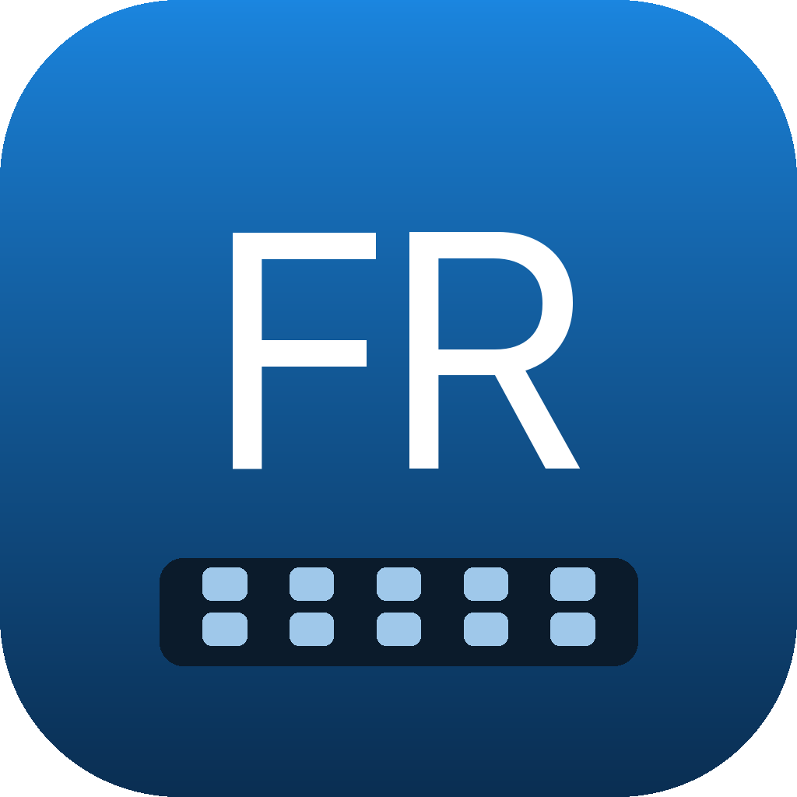
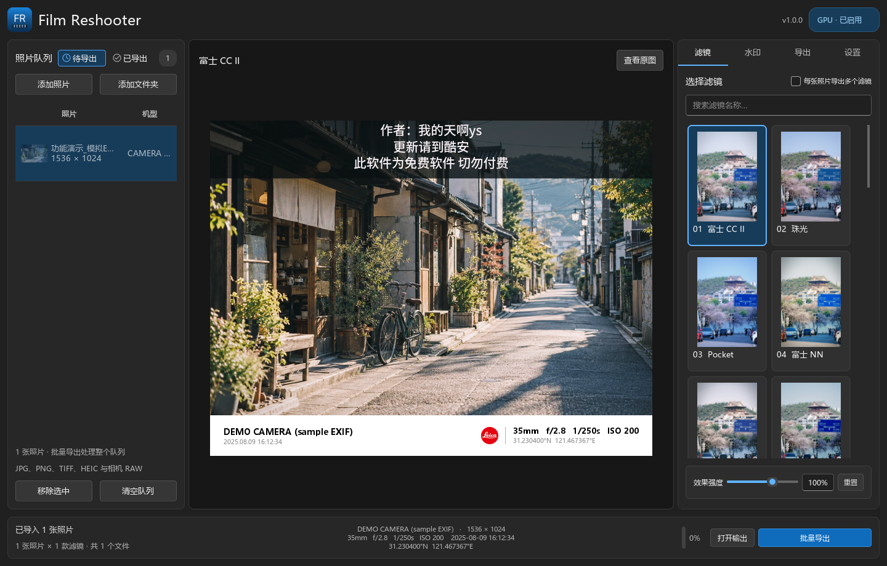

<p align="center"></p>

# Film Reshooter

**面向 Windows 与 Apple Silicon Mac 的本地批量照片滤镜与水印工具。**

导入照片，选择胶片风格滤镜和水印，调整强度，再批量导出。照片处理在本机完成。



## 功能

- 批量添加文件/文件夹、缩略图队列、多滤镜导出、待导出/已导出分类和底栏进度。
- 27 款滤镜：23 款 LUT，以及 M9 23/24/26 号与 M3 25 号实验滤镜。
- 85 套水印、188 种版式；机型、焦距、光圈、快门、ISO、日期、时间及已有 GPS 独立控制。
- 模板已有信息不重复，可关闭“补充模板缺少的信息”；没有 GPS 时不虚构坐标。
- JPEG、PNG、PNG 16-bit、TIFF 16-bit、Ultra HDR JPEG，EXIF 保留独立控制。
- 浅色/深色/跟随系统主题、滤镜与水印静态样例、原图对比、预览缓存、禁用滚轮误改参数。

## 平台与状态

| 平台 | 目标 | 默认路径 | 此合并版状态 |
| --- | --- | --- | --- |
| Windows | x64 | OpenGL 图像处理、M9 DirectML、M3 原生 C | 本机回归通过 |
| macOS | macOS 14+，Apple Silicon arm64 | Metal、原生 C、M9 CoreML | 源码已合并，待 Mac 实机复测 |

两边共用最新界面和水印控制，保留徕卡5方向、机型字体和信息去重修复。macOS 原包较早的公共实现没有覆盖这些修改，详见 [合并记录](docs/MERGE.md) 和 [验证记录](docs/VALIDATION.md)。

CoreML 由系统调度 CPU、GPU 或 ANE；启用提供程序不等于已证明 ANE 在运行。它可能与精确 CPU 推理存在数值差异，可在设置中关闭 M9 CoreML 或选择 CPU。NVIDIA 专用 M9 后端仍是 Windows 可选实验功能。

## 安装应用

Windows 应用 ZIP 完整解压后启动 `FilmReshooter.exe`；macOS DMG 中的应用拖入“应用程序”。首次启动与常见问题见 [安装指南](docs/INSTALL.md)。

仓库是合并源码，不含本次新构建的 EXE、APP 或 DMG。旧安装包不能代表此合并版本已经过两平台实机验证。

## 从源码运行

Windows 建议使用 64 位 Python 3.11：

```powershell
py -3.11 -m venv .venv
.venv\Scripts\python.exe -m pip install -r requirements-windows.txt
.venv\Scripts\python.exe dev.py doctor
.venv\Scripts\python.exe dev.py run
```

macOS 使用原生 arm64 Python，建议 Python 3.13：

```bash
xcode-select --install
python3 -m venv .venv
.venv/bin/python -m pip install -r requirements-macos.txt
.venv/bin/python dev.py native
.venv/bin/python dev.py doctor
.venv/bin/python dev.py run
```

macOS `native` 从合并后的 C/Objective-C 源码重建六个 dylib。随附 dylib 来自输入包，不作为本次重新编译成功的证明。首次安装依赖需要联网，正常处理照片不上传照片。

## 测试与构建

```bash
python dev.py test --portable
python dev.py test
python -m pip install -r requirements-dev.txt

# Windows 标准版；默认不带 NVIDIA 专用组件
python dev.py build --edition standard

# Windows 全量版，可选
python tools/install_nvidia.py
python dev.py build --edition full

# macOS arm64
python dev.py build
```

两种 Windows 构建默认仍是 DirectML。大型 NVIDIA 可选运行库由安装脚本获取，已从源码仓库和 Git 跟踪规则中排除。构建及测试要求见 [BUILD.md](docs/BUILD.md)。

命令行导出：

```bash
python cli.py --list
python cli.py examples --output ./output --filter 0 --backend cpu --watermark original --template leica/1
```

## 代码导航

| 路径 | 用途 |
| --- | --- |
| `app.py` / `fluent_ui.py` | 公共 Qt 界面、照片队列与导出流程 |
| `engine.py` / `gpu*.py` | CPU/OpenGL 渲染 |
| `metal_renderer.py` / `tools/metal_tonefilm.m` | Metal 适配与内核 |
| `m3.py` / `m9.py` / `desktop_*.py` | 原生算法和推理编排 |
| `watermark_info.py` / `original_marks.py` | 信息控制、水印模板布局 |
| `assets` / `research/models` / `lib/arm64-v8a` | LUT、模型、字体、水印、原生与参考资源 |
| `docs` | 安装、构建、合并、验证和 GitHub 发布说明 |

## 作者与资源

作者：[b站 @柳州市热心市民](https://space.bilibili.com/265409000)、[@萬壹ZoveyOne](https://space.bilibili.com/496444830)。滤镜水印来源：[酷安 @我的天啊ys](https://www.coolapk.com/u/4153527)。

项目由 CameraLook 移植与后续桌面开发演进而来，产品名为 Film Reshooter。模型、LUT、字体、水印及原 APK 参考资源各有权利归属，见 [THIRD_PARTY_NOTICE.md](THIRD_PARTY_NOTICE.md) 和 `第三方许可/`。本次整理不擅自为整个仓库指定 MIT/GPL 等统一许可证。
